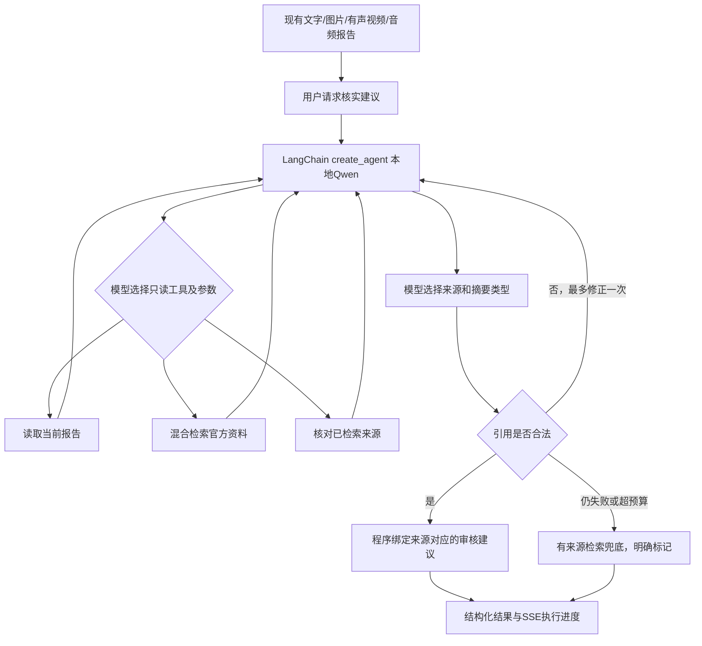

# 本轮设计记录

1. 先按用户提供的评分截图拆项，确认不修改前端，既有功能不能减少。原有advisor是固定顺序代码，不能称为LangChain Agent。
2. 查阅LangChain官方Agents/Models文档，选择create_agent和BaseChatModel；使用本地已有Qwen3-1.7B，不要求新API费用。框架依赖放在.agent-packages，并追加到Python路径，已有检测依赖保留优先级。
3. 模型自主选择只读工具名称及参数，适配器转换成AIMessage.tool_calls；LangChain负责执行、回传ToolMessage和循环。不是让语言模型执行Python字符串。最多4次工具调用，超过预算、未知工具或非法JSON立即进入可辨认兜底。
4. 工具只读取当前报告的检测状态、审核资料。没有任意文件路径、联系人、拨号、支付、网络URL或命令行执行工具。引用只允许使用本次工具返回的资料；建议必须与引用支持的动作一致。
5. 审核知识库从5条扩到9条，增加涉案保密、安全账户、共享屏幕和公开假好友借款案例。保留来源和日期，摘要不伪称原文。检索使用BM25、字符TF-IDF余弦、场景词扩展和RRF；没有把字符检索伪称为神经语义向量模型。
6. 保留原advice接口及其summary/actions/sources/trace等字段；增加新的Agent、SSE、反馈、统计接口。Agent只解释已经生成的报告，不改变检测分数，也不在每次媒体检测后自动增加多轮推理等待。
7. SSE输出已执行工具和校验状态，供未来前端显示进度；不是隐含思维链。此次不改前端，已有页面仍可调用原建议接口。
8. 审计仅保存case_id、步骤、来源ID、耗时及状态，不保存提问、转写文字或原媒体。反馈仅用于人工复核，防止用户自报标签直接污染模型。删除报告联动清理新增数据。
9. 先冻结12个人工检索检查场景，再跑旧版和新版对比；该对比同时改变资料库与检索器，不能把改善全部归因于算法。真实模型验收必须记录mode=langchain_agent；fallback不能充数。
10. 原有58项回归首次遇到后台任务3秒等待超时，断言退出后异步任务越过mock范围，造成后续临时目录已删除。将该集成测试改为30秒截止等待，仍要求任务确实完成，不放宽功能断言；保留失败日志以便审查。

## 怎么复测

在项目根目录PyCharm终端：

```powershell
powershell -ExecutionPolicy Bypass -File .\setup_agent.ps1
python verify_agent_upgrade.py
python verify_agent_upgrade.py --live
python -m unittest test_agent_upgrade
```

第一次安装已由助手执行，不必每次重装。需使用启动脚本配置的GPU Python。纯检索不使用GPU；--live实际加载本地语言模型，耗时随其他训练负载变化。测试输出在reports/agent-upgrade-check.json；私有输入不写入参赛包。

## 框架依据

- LangChain官方Agents：https://docs.langchain.com/oss/python/langchain/agents
- LangChain官方Models：https://docs.langchain.com/oss/python/langchain/models
- create_agent参考：https://reference.langchain.com/python/langchain/agents/factory/create_agent
- 工具调用采用评分表允许的Function Calling路径，没有声称提供了MCP服务端。

## 验收边界

新增技术不能自动提高图像、音频或视频检测器的独立准确率。大模型核实建议质量需要更多真实案例验证。老人试用、新前端可访问性、流式进度展示和商业试点均未完成，评分对照表明确保留缺项。

11. 真实模型第一次测试暴露自定义JSON工具格式不稳，保留agent-live-first-failure.log，改用Qwen原生tool_calls模板；随后发现模型会选择与引用不匹配的action，校验拒绝，没有将其交给用户。尝试一次自我修正仍不能稳定解决，最终让模型只选summary_key和source_ids，程序从实际来源绑定已审核动作。原有接口仍返回完整selection，来源伪造仍拒绝。相关失败记录保留在runtime，未伪报成功。
12. 最终真实模型三场景全部完成LangChain工具调用及引用校验。结果见reports/agent-upgrade-check.json；不代表大样本稳定率。依赖安装警告涉及已有PyYAML版本约束，实际加载仍来自原先lensguard/.packages，不是新目录覆盖，全部回归仍需通过。

## 工作流（与现有检测解耦）



这张图中的引用校验和渲染是应用层安全边界，工具循环由真正LangChain/LangGraph执行；不是声称图中每一块都是LangGraph原生节点。

13. 实际HTTP冷/热启动均完成公开带声伪造视频、Agent SSE、反馈和删除。媒体三项本轮冷启动133.5秒、热启动25.4秒；另行请求的Agent耗时分别38.1和49.8秒。冷启动较慢，记录实际结果，不拿先前样本的19秒当保证。Agent并未强制加入普通媒体分析流程。最终70项回归通过。
